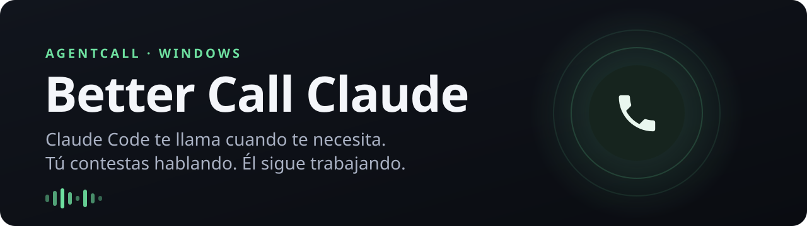
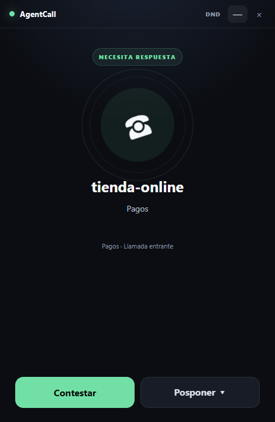
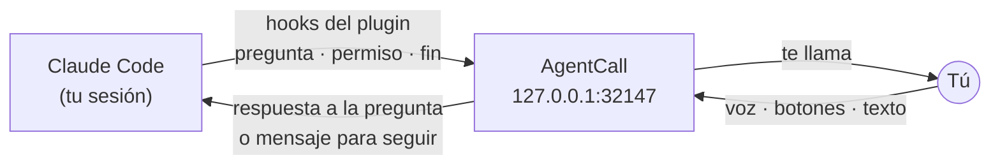

<p align="center">
  
</p>

<p align="center">
  
  
  
  
</p>

Dejas a Claude Code trabajando y te vas a hacer otra cosa. Cuando tiene una pregunta, necesita un permiso
o termina algo importante, **AgentCall te llama** como si fuera un teléfono: te lo cuenta en voz alta,
le contestas hablando y Claude sigue trabajando con tu respuesta. Sin volver al teclado.



**Lo que hace**

- 📞 **Te llama solo cuando merece la pena**: preguntas, permisos y trabajo terminado. El resto se queda en la terminal.
- 🗣️ **Hablas con normalidad**: el micro se abre al descolgar, puedes hacer pausas y, si hablas mientras Claude habla, se calla y te escucha.
- 👆 **Respuestas en un toque**: en preguntas de opciones (A/B/C, sí/no) también tienes botones.
- ⌨️ **Texto cuando quieras**: lo que dice Claude y lo que dices tú se ve en pantalla; puedes escribir en mitad de la llamada.
- ⏰ **Posponer y Pendientes**: pospón de 1 minuto a 2 horas; si no contestas en 30 s, la llamada queda en Pendientes para devolverla luego.
- 🔕 **No molestar** y **varias sesiones a la vez**: una llamada activa y las demás en cola, a la vista.
- 🔒 **Local y sin grabaciones**: el reconocimiento de voz va en tu equipo con Whisper y no se guarda ningún audio.

<br clear="right">

## Instalación

Abre **PowerShell** y pega:

```powershell
irm https://raw.githubusercontent.com/Maybe-Sama/better-call-claude/main/install.ps1 | iex
```

Tarda unos minutos la primera vez (descarga ~1,5 GB entre la app, Whisper y la voz). El instalador:

1. Instala con `winget` lo que falte: Git, Node.js y Python.
2. Descarga AgentCall en `%LOCALAPPDATA%\AgentCall\app` e instala Whisper y la voz.
3. Registra el plugin en Claude Code y añade el comando `/saul`.
4. Crea el acceso directo **AgentCall** en el escritorio y en el menú Inicio, y abre la app.

**¿Tienes una tarjeta gráfica decente?** (AMD, NVIDIA o Intel). Instala el reconocimiento grande en la GPU: entiende bastante mejor y responde en menos de un segundo. Son unos 2 GB más.

```powershell
$env:AGENTCALL_GPU = '1'; irm https://raw.githubusercontent.com/Maybe-Sama/better-call-claude/main/install.ps1 | iex
```

Para actualizar, vuelve a ejecutar el mismo comando.

> Necesitas [Claude Code](https://claude.com/claude-code) instalado y con sesión iniciada, Windows 10/11, un micrófono y altavoces o auriculares.

## Uso

1. Abre **AgentCall** (acceso directo del escritorio). Se queda en una ventana pequeña esperando llamadas.
2. En cualquier sesión **nueva** de Claude Code escribe:

| Comando | Qué hace |
| --- | --- |
| `/saul on` | Claude te llamará en esta sesión. |
| `/saul off` | Vuelve a ser una sesión normal de terminal. |
| `/saul` | Te dice si las llamadas están activadas. |

Las llamadas vienen **apagadas** en todas las sesiones: solo te llama la sesión en la que actives `/saul on`. Puedes tener una sesión que te llama y otras cinco en silencio.

**Durante la llamada:**

- **Contestar**: el micro ya está abierto. Habla; cuando termines verás una cuenta atrás corta antes de que se envíe. Si sigues hablando, se espera y lo junta todo.
- **Botones**: en preguntas de opciones, pulsa la respuesta directamente.
- **Velocidad**: el botón `1×` cambia la velocidad de la voz.
- **Posponer**: elige cuándo te vuelve a llamar.
- **Colgar**: si Claude había terminado, la sesión sigue en la terminal como siempre.

Si contestas en la terminal en vez de en la llamada, la llamada se retira sola. Y si AgentCall está cerrado, Claude Code funciona exactamente igual que sin él.

## Cómo funciona



- El plugin `agentcall` añade *hooks* a Claude Code: `AskUserQuestion`, `PermissionRequest`, `Stop`, `UserPromptSubmit`, etc.
- AgentCall retiene el hook mientras dura la llamada y devuelve tu respuesta a Claude Code. Al terminar un trabajo, lo que dices en la llamada vuelve a la misma sesión y Claude continúa.
- **Reconocimiento**: Whisper local (CPU `small`, o `large-v3-turbo` en la GPU con DirectML).
- **Voz**: Microsoft Edge neural (`es-ES-AlvaroNeural`, necesita internet); sin conexión usa Kokoro, local.
- Todos los hooks fallan "abiertos": si AgentCall no responde, Claude Code sigue como si no existiera.

## Privacidad

- No se graba ni se guarda audio. Solo se guarda el estado operativo de las llamadas (pendientes, pospuestas, No molestar).
- Whisper y Kokoro funcionan en tu equipo. La voz de Edge envía al servicio de Microsoft **el texto** que dice Claude, nunca tu voz. Si prefieres que todo sea local, usa `"ttsProvider": "kokoro"`.
- AgentCall solo escucha en `127.0.0.1`: nada de la red puede hablar con él.

## Configuración

Opcional, en `%LOCALAPPDATA%\AgentCall\config.json`. Reinicia AgentCall tras cambiarlo.

```json
{
  "mic": "BEHRINGER",
  "micGain": 0.6,
  "ttsProvider": "edge",
  "edgeVoice": "es-ES-AlvaroNeural",
  "vocab": "Supabase, Next.js, Vercel"
}
```

| Clave | Para qué |
| --- | --- |
| `mic` | Parte del nombre del micrófono que quieres usar (por defecto, el de Windows). |
| `micGain`, `speechThreshold` | Sensibilidad. Bájala si recoge ruido de fondo y súbela si no te oye. |
| `ttsProvider` | `edge` (más natural, online) o `kokoro` (local). |
| `edgeVoice`, `edgeRate` | Voz de Edge (`es-ES-ElviraNeural`, `es-MX-JorgeNeural`…) y velocidad (`+10%`). |
| `voice` | Voz de Kokoro (`ef_dora`, `em_alex`…). |
| `whisperBackend` | `dml` para la GPU, `cpu` por defecto. |
| `vocab` | Palabras que deberían entenderse bien: nombres de proyectos, librerías… |
| `defaultMode` | `on` para que **todas** las sesiones llamen sin `/saul on`. |
| `minResultSeconds` | Duración mínima de un turno para llamarte al terminar (por defecto 20 s). |

## Problemas frecuentes

| Qué pasa | Qué hacer |
| --- | --- |
| `/saul` dice que AgentCall no está abierto | Abre el acceso directo **AgentCall** y repite el comando. |
| `Unknown command: /saul` | Abre una sesión nueva de Claude Code después de instalar. |
| No me entiende bien | Usa un micro cercano, ajusta `mic` y `micGain`, añade tus palabras a `vocab` o instala la versión GPU. |
| Recoge ruidos o la tele | Baja `micGain` (p. ej. `0.5`) o sube `speechThreshold` (p. ej. `0.03`). |
| No oigo nada | Revisa la salida de audio predeterminada de Windows. |
| Me llama al terminar cosas triviales | Sube `minResultSeconds`. |

## Desinstalar

```powershell
claude plugin uninstall agentcall@better-call-claude
claude plugin marketplace remove better-call-claude
Remove-Item "$env:USERPROFILE\.claude\commands\saul.md", "$env:USERPROFILE\Desktop\AgentCall.lnk",
  "$env:APPDATA\Microsoft\Windows\Start Menu\Programs\AgentCall.lnk"
Remove-Item -Recurse "$env:LOCALAPPDATA\AgentCall"
```

## Desarrollo

```powershell
git clone https://github.com/Maybe-Sama/better-call-claude.git
cd better-call-claude
powershell -ExecutionPolicy Bypass -File .\scripts\setup-windows.ps1   # npm install, tests, Whisper y voz
npm start                                                              # abre AgentCall
npm test                                                               # tests del broker de llamadas
```

`scripts/run-claude-with-agentcall.ps1` abre Claude Code con el plugin de esta carpeta y las llamadas ya activadas.

| Ruta | Contenido |
| --- | --- |
| `src/broker.js` | Lógica de llamadas: cola, pendientes, posponer, emparejado de respuestas. |
| `src/main.js` | App Electron, servidor de hooks, procesos de voz. |
| `src/renderer/` | Interfaz de la llamada. |
| `src/speech/` | Workers de Whisper (CPU/GPU) y voz (Edge/Kokoro). |
| `claude-plugin/` | Plugin de Claude Code (hooks). |
| `claude-commands/saul.md` | Comando `/saul`. |
| `docs/` | [Especificación](docs/SYSTEM_SPEC.md), [contrato de hooks](docs/HOOK_CONTRACT.md) y [plan de pruebas](docs/TEST_PLAN.md). |

## Estado

Prototipo (v0.1), probado con Claude Code 2.1.289 en Windows 11. Solo Windows y voz en español por ahora. La parte que habla con Claude Code está separada del sistema de llamadas, así que se pueden añadir otros agentes sin rediseñarlo.
